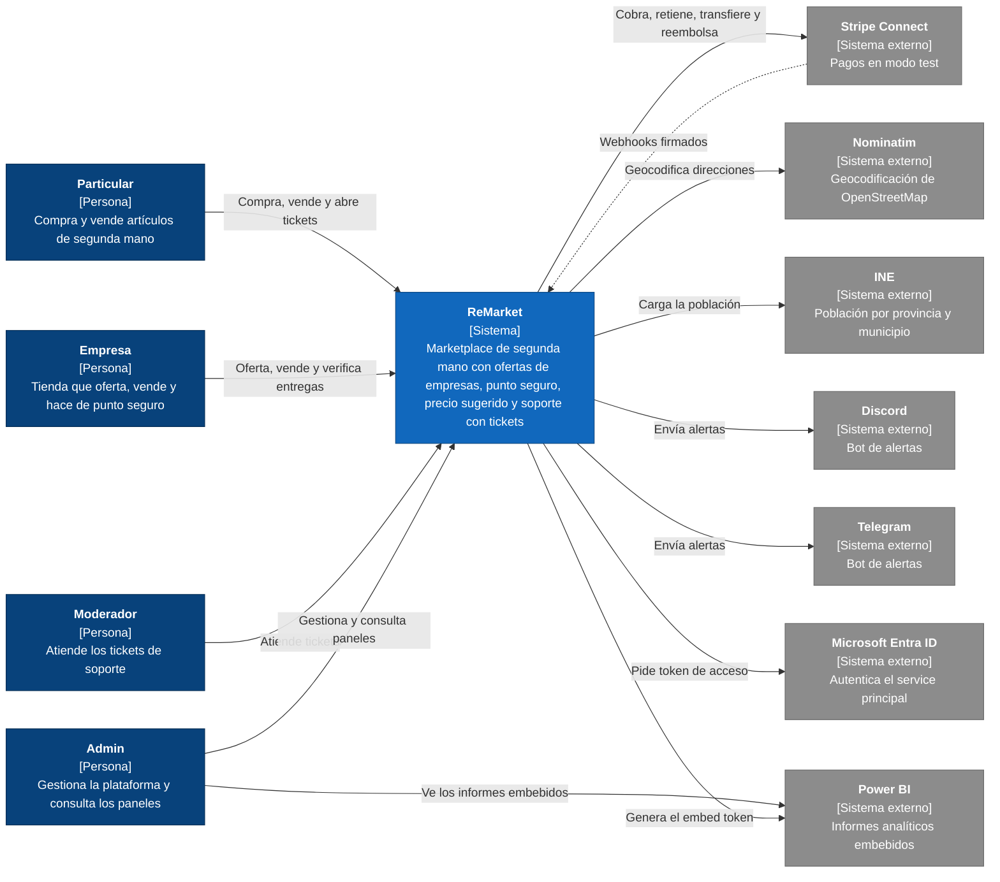

# Diagrama C4 de contexto

Nivel 1 del modelo [C4](https://c4model.com/): ReMarket como un único sistema, las personas que lo usan y los sistemas externos con los que se integra. Lo que hay dentro de ReMarket (backend, frontend, servicios Python, PostgreSQL, Redis y MinIO) queda para el diagrama de contenedores.

**Leyenda:** azul oscuro, personas; azul, el sistema ReMarket; gris, sistemas externos. Cada flecha va de quien inicia la interacción a quien la recibe; la discontinua marca los webhooks, que Stripe envía a ReMarket de forma asíncrona.

> El diagrama usa un `flowchart` de Mermaid con la notación y los colores de C4 en lugar del tipo `C4Context`. Con `C4Context`, Mermaid coloca los elementos en filas fijas y las etiquetas de las relaciones se solapan entre sí y con las cajas; el `flowchart` reparte los elementos y las etiquetas automáticamente y se lee bien en GitHub.

## Elementos

### Personas

| Persona | Papel |
|---|---|
| Particular | Compra y vende. Decide si sus anuncios aceptan ofertas de empresas, acepta o rechaza las que recibe, abre tickets y recibe alertas en Discord o Telegram. |
| Empresa | Tienda de segunda mano validada mediante ticket. Publica su stock, oferta a mano por anuncios de particulares, hace de punto seguro y consulta su panel. |
| Moderador | Equipo de soporte interno. Atiende la bandeja de tickets, ejecuta las acciones de resolución y escala al admin lo que excede sus permisos. |
| Admin | Responsable de la plataforma. Gestiona usuarios, empresas y configuración, resuelve los tickets escalados y consulta el panel global y los informes de Power BI. |

### Sistemas externos

| Sistema | Para qué lo usa ReMarket |
|---|---|
| Stripe Connect | Solo en modo test. Cuentas Express para vendedores, cobro al comprador con retención y transferencia al vendedor al completar el pedido, descontando la comisión ("separate charges and transfers"). Reembolsos desde los tickets. Stripe avisa a ReMarket por webhooks firmados en `/api/webhooks/stripe`. |
| Nominatim | Geocodifica direcciones desde el backend, con `User-Agent` propio, como máximo una petición por segundo y caché en Redis. |
| INE | Su API JSON Tempus da la población por provincia y municipio. Un script Python la carga para normalizar métricas por habitante. |
| Discord | El usuario vincula su cuenta con un código del bot y recibe alertas de búsquedas guardadas, ofertas, pedidos y tickets. Los admins reciben el informe semanal en un canal. |
| Telegram | Las mismas alertas que Discord, a través de su propio bot. |
| Microsoft Entra ID | Autentica el service principal con el que el backend pide acceso a Power BI (patrón "app owns data"). |
| Power BI | El backend genera el embed token en `GET /api/admin/bi/embed-token` y el navegador del admin carga los informes embebidos. Desactivado por defecto con `app.bi.powerbi.enabled`. |
